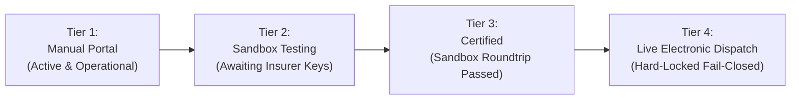
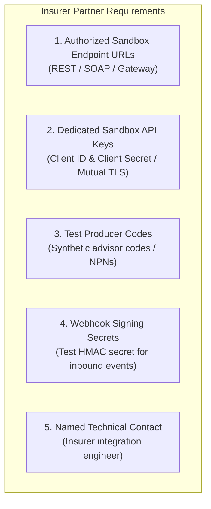
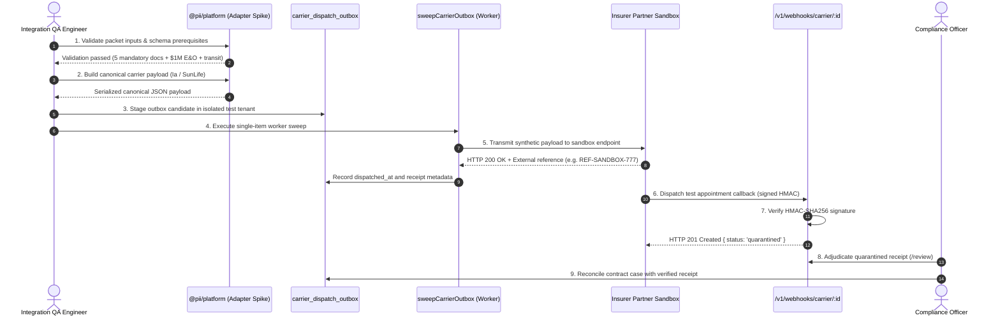

# PII Carrier Sandbox Certification & Controlled Testing Protocol (Phase 6 Track B)

**Document Version:** 1.0.0  
**Target Milestone:** Phase 6 — Operational Onboarding & Carrier Certification  
**Target Carriers:** iA Financial Group (`ia-financial-group`) & Sun Life Financial (`sun-life`)  
**Safety Protocol:** External insurer network dispatch remains fail-closed (`allowExternalDispatch: false`).

---

## 1. Executive Purpose & Four-Tier Architecture

To protect insurance agency compliance and eliminate misleading connectivity claims, PII enforces a strict four-tier connection taxonomy across all user dashboards and backend systems:



| Connection Tier | Operational Definition | Current Status | Dispatch Channel |
| :--- | :--- | :---: | :--- |
| **Tier 1: Manual Portal** | Contracting packages assembled, hash-verified, e-signed by broker, and submitted manually through carrier advisor portals (iA Advisor / Sun Life Connect). Inbound receipts quarantined. | **ACTIVE** | Manual download & portal upload |
| **Tier 2: Sandbox Testing** | Software adapter spikes staged in PII. Testing conducted against insurer-provided test endpoints using synthetic payloads and test credentials. | **AWAITING CREDENTIALS** | Isolated partner test endpoints only |
| **Tier 3: Certified** | End-to-end sandbox roundtrips successfully executed with 100% pass rate, verified failure injection, replay rejection, and bilateral technical sign-off. | **PENDING** | Blocked |
| **Tier 4: Live Dispatch** | Direct production API transmission. Governed by bilateral agreements, Data Protection Addenda (DPA), KMS dual secrets, and explicit feature flags. | **HARD-LOCKED (Fail-Closed)** | `allowExternalDispatch: false` |

> [!IMPORTANT]
> **Regulatory Truthfulness Principle:** Software adapter readiness does NOT constitute insurer authorization. A carrier cannot be advanced to Tier 2 without insurer-issued sandbox credentials, nor to Tier 4 without signed bilateral contracts and production certification.

---

## 2. Insurer Sandbox Prerequisites Checklist

Before executing sandbox certification tests for **iA Financial Group** or **Sun Life Financial**, Head Office compliance and engineering must obtain the following assets from the insurer's partner integration team:



### Required Information Matrix

| Carrier | Target Technical Interface | Mandatory Sandbox Deliverables |
| :--- | :--- | :--- |
| **iA Financial Group** | iA Contracting Gateway / Partner API | • Sandbox endpoint: `https://api.sandbox.ia.ca/advisor/contracting/v1`<br>• Test OAuth 2.0 Client ID & Secret<br>• Dedicated test Advisor Code (e.g. `IA-TEST-99001`)<br>• Inbound test webhook endpoint configuration<br>• Test HMAC secret for signature verification |
| **Sun Life Financial** | Sun Life Connect / Advisor E-Contracting API | • Sandbox endpoint: `https://api-sandbox.sunlife.com/advisor/v1/contracting`<br>• API Key & Mutual TLS client certificate (if mandated)<br>• Test Producer ID (e.g. `SL-TEST-88002`)<br>• Sandbox webhook callback subscription |

---

## 3. End-to-End Sandbox Certification Lifecycle

Sandbox certification is divided into five sequential validation stages. Every stage must pass with zero defects before technical certification is granted.



---

## 4. Test Suite Execution & Failure Injection Matrix

To achieve **Tier 3 (Certified)** status, the following automated and simulated scenarios must be executed against the sandbox environment:

| Test ID | Test Scenario | Expected System Behavior | Acceptance Criteria |
| :--- | :--- | :--- | :--- |
| **CERT-01** | Happy Path Contract Packet Dispatch | Adapter serializes canonical payload with all 5 mandatory documents, transmits to sandbox, and logs external acknowledgment reference. | External reference stored in outbox record; HTTP 200 from sandbox. |
| **CERT-02** | Missing Document Rejection | Input missing `banking_void_cheque` or `carrier_app_schedule`. | Validation throws error immediately; zero network packets transmitted. |
| **CERT-03** | Sub-minimum E&O Coverage | Input provides E&O policy with $500,000 coverage (below $1,000,000 requirement). | Adapter rejects input with explicit coverage threshold error. |
| **CERT-04** | Quebec Bill 96 / Law 25 Parity | Input for `jurisdiction: 'QC'` with English correspondence preference. | Validation generates French documentation warning; payload sets language to `fr-CA`. |
| **CERT-05** | Inbound Webhook Quarantine | Sandbox sends signed webhook callback with appointment confirmation. | Webhook returns HTTP 201; receipt stored in `quarantined` state; internal contract remains unchanged. |
| **CERT-06** | Inbound Webhook Replay Attack | Same webhook payload retransmitted with identical `external_event_id`. | Webhook rejected with HTTP 409 Conflict or handled idempotently without duplicate receipt. |
| **CERT-07** | Tampered Webhook Payload | Raw payload body modified after signature generation. | Webhook rejected with **HTTP 401 Unauthorized** (raw-body HMAC mismatch). |
| **CERT-08** | Secret Key Rotation | Webhook signed using `_SECONDARY` secret while `_PRIMARY` remains active. | Webhook verifies successfully; zero dropped receipts during rotation. |
| **CERT-09** | Outbox Worker Idempotency | Simulated network timeout during dispatch. Worker retries using identical `idempotency_key`. | Insurer sandbox returns original transaction without duplicate submission. |
| **CERT-10** | Active Compliance Hold Gate | Contract has an active compliance hold (`carrier_compliance_holds`). | Worker sweep revalidates context and blocks dispatch immediately with `CarrierConnectionUnavailable`. |

---

## 5. Formal Certification Sign-Off Sheet

Once all 10 test scenarios pass, the certification sign-off sheet must be signed by both the PII Lead Architect and the Carrier Technical Integration Lead:

```
================================================================================
           PII CARRIER TECHNICAL SANDBOX CERTIFICATION SIGN-OFF
================================================================================

Carrier: ____________________________________________________________________
Carrier Technical Representative: ___________________________________________
Test Environment: Insurer Partner Sandbox (Certified)
Date of Certification: ______________________________________________________

Results Summary:
  [ ] Happy path serialization & transmission: PASSED (10/10)
  [ ] Mandatory document checklist validation: PASSED
  [ ] E&O coverage threshold verification: PASSED ($1M+ verified)
  [ ] Banking Canadian transit format verification: PASSED
  [ ] Quebec Bill 96 French language compliance: PASSED
  [ ] Inbound HMAC-SHA256 signature verification: PASSED
  [ ] Quarantined receipt adjudication lifecycle: PASSED
  [ ] Idempotency & replay attack guards: PASSED
  [ ] Negative failure injection & compliance holds: PASSED

Signatures:
Lead Systems Architect (PII): ____________________________ Date: ____________
Chief Compliance Officer (PII): __________________________ Date: ____________
Carrier Integration Representative: ______________________ Date: ____________
================================================================================
```

---

## 6. Advancing to Tier 4 (Live Production Dispatch)

Following technical sandbox certification, advancing any carrier to **Tier 4 (Live)** requires formal completion of all five release gates:

1. **Gate 1 (Legal):** Countersigned bilateral API terms and Data Protection Addendum on file.
2. **Gate 2 (Technical):** Completed Sandbox Certification Sign-Off (this protocol).
3. **Gate 3 (Security):** 256-bit tenant-scoped HMAC keys provisioned in Railway environment.
4. **Gate 4 (Operations):** Outbox worker transactional leasing (`SKIP LOCKED`) and backoff verified.
5. **Gate 5 (Governance):** Tenant administrator explicitly enables feature flag:
   ```bash
   ALLOW_EXTERNAL_CARRIER_DISPATCH_<CARRIER_ID>=true
   ```
Until all five gates are completed, **`allowExternalDispatch: false` remains strictly enforced fail-closed**.
