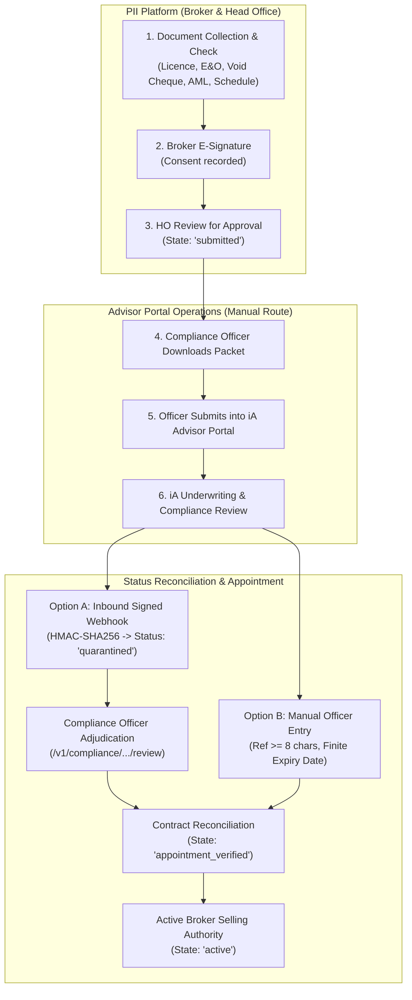
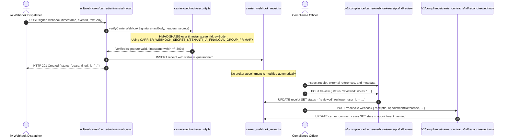

# iA Financial Group (Industrial Alliance) Onboarding & Technical Integration Specification

**Carrier Identifier:** `ia-financial-group`  
**Display Name:** iA Financial Group (Industrial Alliance)  
**Jurisdiction:** Canada (`country: 'CA'`, Provinces: `ON`, `QC`, `BC`, `AB`, `MB`, `SK`, `NS`, `NB`, `NL`, `PE`)  
**Operating Connection Mode:** `readiness_verified (manual_portal_only)`  
**Live Connectivity Status:** **NOT CONNECTED** (External insurer dispatch fail-closed: `allowExternalDispatch: false`)  
**Document Version:** 1.0.0 (Phase 5)

---

## 1. Regulatory Context & Operational Architecture

iA Financial Group is a major Canadian life and health insurer. In accordance with PII governance standards, **internal contract preparation or product activation must never be represented as insurer authorization**. 

At present, contracting cases for iA Financial Group operate via **manual advisor portal workflows** while inbound webhook verification, adjudication, and outbound adapter spikes are fully staged in software.



---

## 2. Mandatory Contracting Document Checklist

Before a contract case can transition to `documents_prepared`, all five mandatory documents must be uploaded to the vault, hash-verified, and validated against statutory criteria:

| Document Type | Technical Key | Statutory Requirement & Verification Rule | Minimum Threshold |
| :--- | :--- | :--- | :--- |
| **1. Provincial Licence** | `licence` | Life and Accident & Sickness licence issued by provincial regulator (FSRA in Ontario, AMF in Quebec, BCSC/Insurance Council in BC). | Province match, active expiry date > current date. |
| **2. E&O Insurance** | `eo_insurance` | Certificate of Insurance covering errors, omissions, and professional negligence for financial advisors. | **$1,000,000 per claim / $2,000,000 aggregate**, current policy term. |
| **3. Direct Deposit Authorization** | `banking_void_cheque` | Void cheque or official financial institution direct deposit authorization letter. | Canadian transit format: **3-digit institution + 5-digit branch transit + 5-12 digit account**. |
| **4. AML Certificate** | `aml_cert` | Anti-Money Laundering & Terrorist Financing training certificate from an accredited provider (Advocis, IFSE, or corporate academy). | Completed within preceding **12 months**. |
| **5. iA Schedule & Agreement** | `carrier_app_schedule` | iA Direct Contracting Schedule and Producer Declaration with provincial disclosures. | Form version matched, signed by broker. |

---

## 3. Quebec Dual-Language Compliance (Bill 96 / Law 25)

For brokers contracting in Quebec (`jurisdiction: 'QC'`) or requesting French correspondence:

1. **Language Parity:** All contract schedules, consent forms, and client privacy notices must be rendered and executed in **Canadian French (`fr-CA`)**.
2. **Statutory Notice:** First-login consent must include mandatory Law 25 disclosures regarding personal information governance, the officer responsible for data protection, and the right of access/rectification.
3. **Data Residency Disclosure:** Notice must explicitly state whether data is stored within Canada (`stored: 'CA'`) or involves cross-border transfer.

---

## 4. Inbound Webhook Security & Quarantined Receipt Lifecycle

When iA webhook notifications are received, they are cryptographically authenticated and held in quarantine.



### 4.1 Secret Naming & Dual-Secret Rotation

PII strictly rejects global or unsuffixed secrets. Every secret must be tenant-scoped:
- **Primary:** `CARRIER_WEBHOOK_SECRET_${TENANT_ID}_IA_FINANCIAL_GROUP_PRIMARY`
- **Secondary:** `CARRIER_WEBHOOK_SECRET_${TENANT_ID}_IA_FINANCIAL_GROUP_SECONDARY`

To rotate keys without service interruption:
1. Generate new 32-byte secret (64 hex characters).
2. Provision as `_SECONDARY` in Railway environment.
3. Update iA webhook signing key in iA portal.
4. Verify incoming receipts succeed using `_SECONDARY`.
5. Promote `_SECONDARY` to `_PRIMARY` and delete previous key.

---

## 5. Canonical Outbound Adapter Spike (`IaFinancialGroupAdapter`)

PII includes a typed outbound adapter spike in `@pii/platform` (`IaFinancialGroupAdapter`):

```typescript
import {
  getCarrierAdapter,
  IaFinancialGroupAdapter,
  type ContractPacketInput,
} from '@pii/platform';

const adapter = getCarrierAdapter('ia-financial-group') as IaFinancialGroupAdapter;

// 1. Validate all mandatory documents and limits
const validation = adapter.validateContractPrerequisites(packetInput);
if (!validation.valid) {
  console.error('Validation errors:', validation.errors);
}

// 2. Build canonical carrier payload
const payload = adapter.buildContractPacketPayload(packetInput);

// 3. Dispatch is strictly fail-closed until Gate 1-5 approvals
// adapter.dispatch(...) -> Throws CarrierConnectionUnavailable
```

### 5.1 Canonical Payload Schema (`IaContractPacketPayload`)

```json
{
  "carrier": "ia-financial-group",
  "channel": "manual_portal",
  "packetVersion": "2026.1",
  "metadata": {
    "tenantId": "11111111-1111-1111-1111-111111111111",
    "contractId": "22222222-2222-2222-2222-222222222222",
    "submittedAt": "2026-10-19T07:00:00.000Z",
    "jurisdiction": "ON",
    "language": "en"
  },
  "producer": {
    "externalId": "33333333-3333-3333-3333-333333333333",
    "fullName": "Broker Full Name",
    "firstName": "Broker",
    "lastName": "Name",
    "email": "broker@punjabinsurance.ca",
    "phone": "+14165551234",
    "advisorCode": "IA-98765"
  },
  "regulatory": {
    "licenceNumber": "LIC-ON-2026-999",
    "licenceProvince": "ON",
    "licenceClass": "Life and Accident & Sickness",
    "licenceExpiry": "2028-12-31",
    "eoInsurer": "Trisura Guarantee Insurance Company",
    "eoPolicyNumber": "EO-998877",
    "eoPerClaimLimit": 2000000,
    "eoAggregateLimit": 5000000,
    "eoExpiry": "2027-11-30",
    "amlProvider": "Advocis",
    "amlCompletedDate": "2026-01-15",
    "amlValidUntil": "2027-01-15"
  },
  "remittance": {
    "directDepositRouting": "0003-12345",
    "accountNumberMasked": "***6789",
    "bankName": "Royal Bank of Canada"
  },
  "attachments": [
    { "documentType": "licence", "fileName": "licence.pdf", "sha256Checksum": "...", "vaultReference": "vault://..." },
    { "documentType": "eo_insurance", "fileName": "eo.pdf", "sha256Checksum": "...", "vaultReference": "vault://..." },
    { "documentType": "banking_void_cheque", "fileName": "cheque.pdf", "sha256Checksum": "...", "vaultReference": "vault://..." },
    { "documentType": "aml_cert", "fileName": "aml.pdf", "sha256Checksum": "...", "vaultReference": "vault://..." },
    { "documentType": "carrier_app_schedule", "fileName": "schedule.pdf", "sha256Checksum": "...", "vaultReference": "vault://..." }
  ]
}
```

---

## 6. Release Gates Required for Live Electronic Dispatch

Before `allowExternalDispatch` can be toggled to `true` for iA Financial Group, all five release gates must be formally satisfied:

1. **Gate 1: Bilateral Contractual Authorization** — Countersigned API partner agreement, Data Protection Agreement (DPA), and infosec sign-off with iA Financial Group.
2. **Gate 2: Technical Sandbox Certification** — Successful execution of mock submissions, failure retries, and duplicate receipt rejections in iA's certified partner test environment.
3. **Gate 3: KMS Dual-Secret Provisioning** — Tenant-scoped primary and secondary webhook secrets generated with 256 bits of entropy and deployed to Railway.
4. **Gate 4: Outbox Worker Safety Certification** — Verified transactional row leasing (`FOR UPDATE SKIP LOCKED`), exponential backoff, and dead-letter routing.
5. **Gate 5: Scoped Production Feature Activation** — Controlled feature flag activation specifically for the authorized tenant and carrier ID (`ALLOW_EXTERNAL_CARRIER_DISPATCH_IA=true`).
