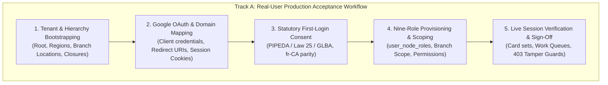
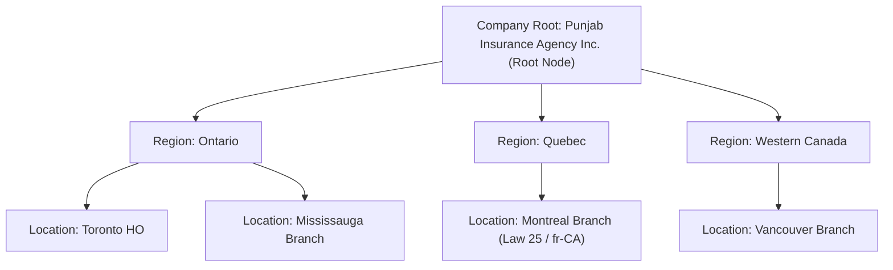
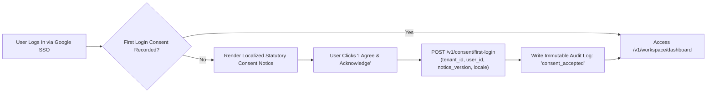

# PII Real-User Production Acceptance Runbook (Track A)

**Document Version:** 1.0.0  
**Target Milestone:** Phase 5 — Track A Real-User Acceptance  
**Target Environments:**  
- Canada: `https://ca.punjabinsurance.co` (Region: `ca-qc`, Storage: `CA`)  
- United States: `https://us.punjabinsurance.co` (Region: `us`, Storage: `US`)  
**Safety Protocol:** External insurer network dispatch hard-locked disabled (`allowExternalDispatch: false`).

---

## 1. Overview & Objective

This runbook guides Head Office administrators, compliance leadership, and systems operators through the end-to-end process of onboarding and verifying real users with production credentials across all nine organizational roles in PII.

Automated acceptance tests (Phase 4) verified database grounding, RLS isolation, work queue navigation, and compliance quarantine using simulated actors. Track A validates these identical controls against production Google Workspace identities, multi-branch organizational hierarchies, and statutory first-login consents.



---

## 2. Tenant & Hierarchy Bootstrapping

PII strictly segregates data using PostgreSQL Row Level Security (`tenant_wall`). Every real-user session is anchored to a verified tenant and organizational hierarchy.

### 2.1 Tenant Record Verification

Verify the target tenant exists in the `tenants` table of `auth_db`:

```sql
-- Query tenant record in auth database
SELECT id, slug, legal_name, country, created_at
  FROM tenants
 WHERE slug IN ('punjab-insurance-ca', 'punjab-insurance-us');
```

If initializing a new tenant, execute the standard tenant bootstrapping migration:

```bash
# From repository root with production DATABASE_URL
node packages/db/src/cli.ts bootstrap-tenant \
  --slug punjab-insurance-ca \
  --name "Punjab Insurance Agency Inc." \
  --country CA
```

### 2.2 Multi-Branch Organizational Tree Structure

Every tenant requires an organizational tree (`org_nodes`) with transitive reach closures (`org_reach`). The hierarchy ensures branch managers, brokers, and staff cannot access sibling branch records.



Verify that organizational nodes and `org_reach` closures are populated:

```sql
SELECT n.id, n.type, n.name, n.parent_id,
       (SELECT COUNT(*) FROM org_reach r WHERE r.ancestor_id = n.id) AS reachable_descendants
  FROM org_nodes n
 WHERE n.tenant_id = '<TENANT_ID>'
 ORDER BY n.type DESC, n.name ASC;
```

---

## 3. Production Authentication & Domain Mapping

PII uses Google Workspace Single Sign-On (OAuth 2.0 + OpenID Connect with PKCE) for enterprise authentication.

### 3.1 Railway Environment Configuration

Ensure the following environment variables are securely provisioned in Railway:

| Environment Variable | Description | Production Requirement |
| :--- | :--- | :--- |
| `APP_ENV` | Application environment identifier | `prod` (strictly forbids `DEV_AUTH`) |
| `REGION` | Jurisdiction region code | `ca-qc` (Canada) or `us` (United States) |
| `GOOGLE_CLIENT_ID` | OAuth 2.0 Client ID from GCP Console | `*.apps.googleusercontent.com` |
| `GOOGLE_CLIENT_SECRET` | OAuth 2.0 Client Secret | 32+ characters, secret key |
| `COOKIE_SECRET` | Secret for signed flow cookies (`pii_flow`) | 32+ cryptographically random bytes |
| `APP_ORIGIN` | Public application URL | `https://ca.punjabinsurance.co` |
| `DATA_COUNTRY` | Regulatory server residency country | `CA` (Canada) or `US` (United States) |

### 3.2 Google Cloud Console OAuth Configuration

In the GCP Console under **APIs & Services > Credentials > OAuth 2.0 Client IDs**:
1. **Authorized JavaScript origins**:
   - `https://ca.punjabinsurance.co` (Canada)
   - `https://us.punjabinsurance.co` (United States)
2. **Authorized redirect URIs**:
   - `https://ca.punjabinsurance.co/auth/google/callback`
   - `https://us.punjabinsurance.co/auth/google/callback`
3. **OAuth Consent Screen**:
   - Application Name: `PII by Punjab Insurance`
   - User Support Email: `support@punjabinsurance.co`
   - Scopes: `openid`, `https://www.googleapis.com/auth/userinfo.email`, `https://www.googleapis.com/auth/userinfo.profile`

### 3.3 Production Cookie Security

The session authenticator produces an HTTP-only, secure session cookie:
- **Cookie Name:** `pii_session`
- **Attributes:** `HttpOnly; Secure; SameSite=Lax; Max-Age=1209600` (14 days)
- **Origin Guard:** State-changing requests (`POST`, `PUT`, `DELETE`, `PATCH`) validate that `Origin` or `Referer` matches `APP_ORIGIN` or whitelisted Chrome extension IDs.

---

## 4. Statutory First-Login Consents

Under Canadian federal law (**PIPEDA**), Quebec provincial law (**Law 25**), and US financial regulations (**GLBA** / state privacy acts), every real user must review and accept statutory disclosures prior to accessing client or carrier data.

### 4.1 Statutory Notice Matrix



| Jurisdiction | Applicable Statute | Required Disclosures | Bilingual Parity |
| :--- | :--- | :--- | :--- |
| **Canada (Federal)** | PIPEDA | Purpose of CRM data collection, client financial disclosure limits, cross-border transfer notices. | English (`en-CA`) |
| **Quebec (`ca-qc`)** | Law 25 & Bill 96 | Explicit consent for electronic records, data governance officer contact, right to erasure, French language interface choice. | **Canadian French (`fr-CA`)** mandatory |
| **United States (`us`)** | GLBA & State Privacy | Non-public personal financial information (NPI) safeguarding, privacy policy, unauthorized access penalties. | English (`en-US`) |

### 4.2 Consent Verification API

- **Check Status:** `GET /v1/consent/first-login`
  - Returns: `{ version: "v1", locale: "fr", text: "...", accepted: false }`
- **Record Acceptance:** `POST /v1/consent/first-login`
  - Body: empty (`{}`)
  - Result: HTTP `204 No Content`
  - Database Effect: Inserts into `consent_records` and logs audit entry `consent_accepted`.

---

## 5. Nine-Role Provisioning & Acceptance Matrix

Head Office administrators must provision at least one real user for each of the nine perspectives to complete acceptance testing.

### 5.1 Role Provisioning Commands (Database / Admin API)

```sql
-- 1. Insert user identity (if not created via Google SSO invitation)
INSERT INTO app_users (tenant_id, email, full_name, status, home_node_id, locale)
VALUES ('<TENANT_ID>', 'real.user@punjabinsurance.ca', 'Real User Name', 'active', '<NODE_ID>', 'en')
ON CONFLICT (tenant_id, email) DO UPDATE SET status = 'active'
RETURNING id;

-- 2. Assign role perspective to node in hierarchy
INSERT INTO user_node_roles (tenant_id, user_id, node_id, role)
VALUES ('<TENANT_ID>', '<USER_ID>', '<NODE_ID>', '<ROLE_NAME>')
ON CONFLICT DO NOTHING;
```

### 5.2 Nine-Role Verification Checklist

| # | Role Perspective | Scope Level | Expected UI Cards | Work Queue Action Target | Tamper Guard Check (Must Return HTTP 403) |
| :-: | :--- | :--- | :--- | :--- | :--- |
| **1** | **Admin** | Tenant Root Node | 8 cards (CRM, Compliance, Onboarding, Training, Learning, Carriers, Audit, Notifications) | Executive tenant oversight, system-wide reviews | Cannot tamper outside own tenant ID |
| **2** | **Head Office** | Multi-Branch Root | 7 cards (All except raw system settings) | Multi-branch approvals, carrier contracting oversight | Sibling tenant endpoints return 403 |
| **3** | **Manager** | Branch Node (e.g. Toronto) | 5 cards (CRM, Onboarding, Training, Carriers, Notifications) | Branch approval queue: Button reads **Review for Approval** (routes to compliance) | Accessing sibling branch node returns 403; cannot verify appointments |
| **4** | **Partner (Broker)** | Personal Node | 5 cards (CRM, Onboarding, Learning, Carriers, Notifications) | Personal onboarding tasks, client pipeline | Accessing peer broker records returns 403; executive summary hidden |
| **5** | **Compliance** | Compliance Node / Root | 5 cards (Compliance, Onboarding, Carriers, Audit, Notifications) | Quarantined webhook receipts, compliance alert adjudication | CRM client mutation returns 403; cannot alter broker compensation |
| **6** | **Auditor** | Independent / Read-Only | 2 cards (Audit, Notifications) | Statutory audit engagements, download package | All mutation endpoints (`POST`, `PUT`, `DELETE`) return 403 |
| **7** | **Trainer** | Branch / Region Node | 3 cards (Training, Learning, Notifications) | Continuing education tracking, course enrollment | CRM and carrier contracting return 403 |
| **8** | **Learner** | Personal Node | 2 cards (Learning, Notifications) | Assigned regulatory modules, CE courses | Management approval routes return 403 |
| **9** | **Staff** | Branch Node | 3 cards (CRM, Learning, Notifications) | High-priority CRM due tasks, meeting preparation | Management approval and compliance review return 403 |

---

## 6. Real-User Acceptance Sign-Off Sheet

Before Phase 5 can be designated as complete for production use, each role must be exercised in the browser by an authorized stakeholder:

| Perspective | Verified Stakeholder (Email) | Date Tested | First-Login Consent Verified | Cards Verified | Work Queue Navigation Verified | Sign-off Status |
| :--- | :--- | :--- | :---: | :---: | :---: | :---: |
| **1. Admin** | _______________________ | __________ | [ ] Yes | [ ] Yes | [ ] Yes | [ ] ACCEPTED |
| **2. Head Office** | _______________________ | __________ | [ ] Yes | [ ] Yes | [ ] Yes | [ ] ACCEPTED |
| **3. Manager** | _______________________ | __________ | [ ] Yes | [ ] Yes | [ ] Yes | [ ] ACCEPTED |
| **4. Partner** | _______________________ | __________ | [ ] Yes | [ ] Yes | [ ] Yes | [ ] ACCEPTED |
| **5. Compliance** | _______________________ | __________ | [ ] Yes | [ ] Yes | [ ] Yes | [ ] ACCEPTED |
| **6. Auditor** | _______________________ | __________ | [ ] Yes | [ ] Yes | [ ] Yes | [ ] ACCEPTED |
| **7. Trainer** | _______________________ | __________ | [ ] Yes | [ ] Yes | [ ] Yes | [ ] ACCEPTED |
| **8. Learner** | _______________________ | __________ | [ ] Yes | [ ] Yes | [ ] Yes | [ ] ACCEPTED |
| **9. Staff** | _______________________ | __________ | [ ] Yes | [ ] Yes | [ ] Yes | [ ] ACCEPTED |

### Lead Sign-Off Signatures

- **Head Office Executive:** __________________________________ &nbsp;&nbsp;&nbsp;&nbsp; **Date:** ______________
- **Chief Compliance Officer:** _______________________________ &nbsp;&nbsp;&nbsp;&nbsp; **Date:** ______________
- **Lead Systems Architect:** ________________________________ &nbsp;&nbsp;&nbsp;&nbsp; **Date:** ______________
